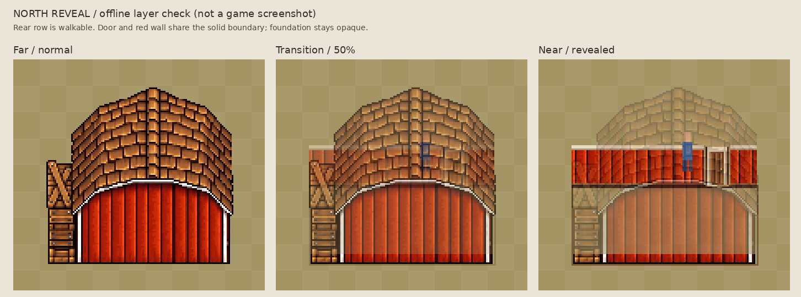
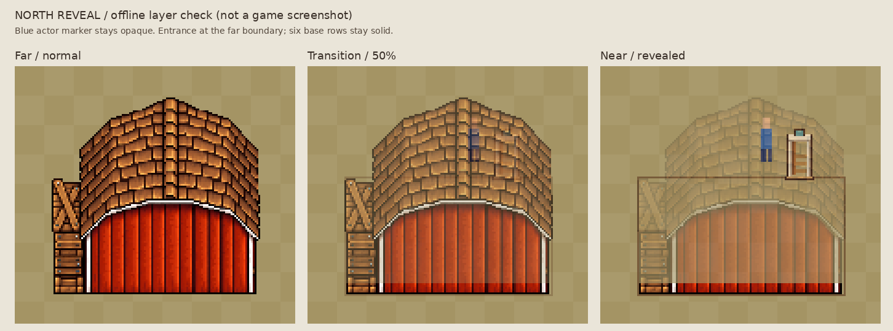
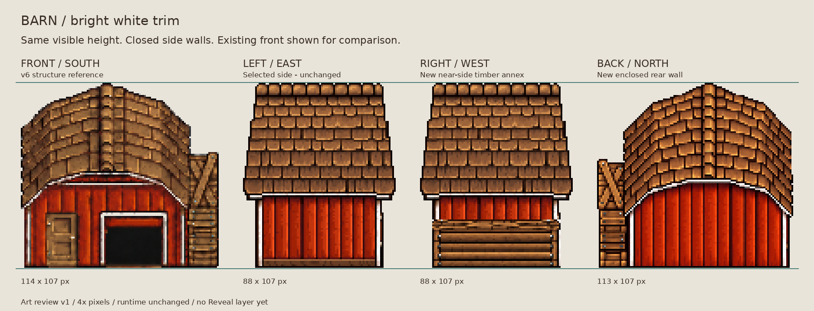
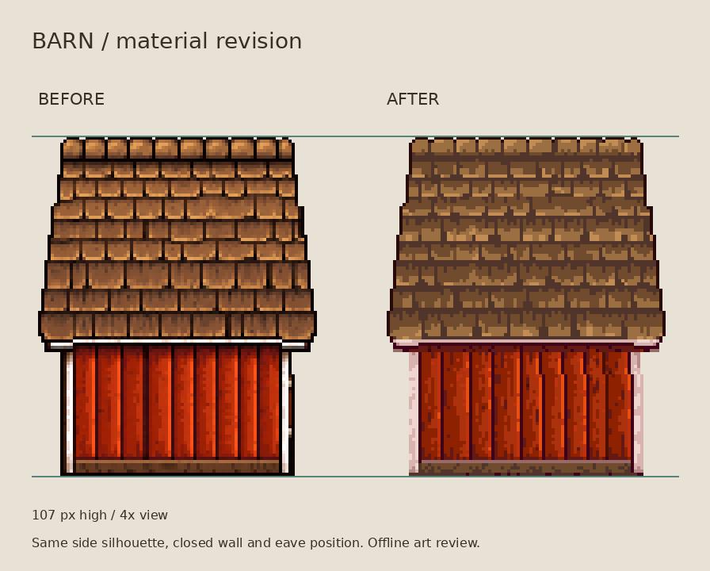
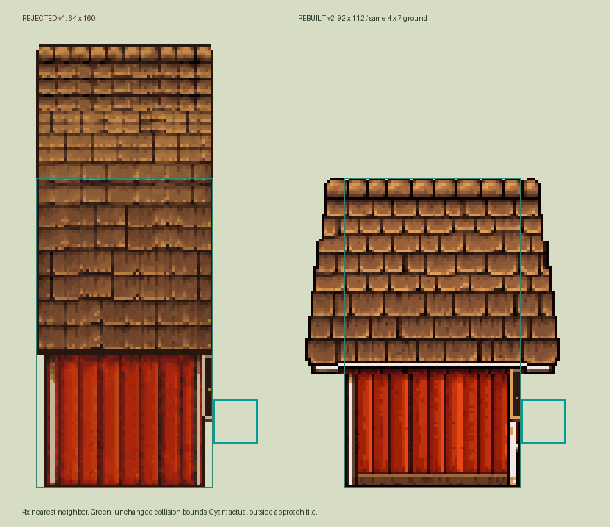
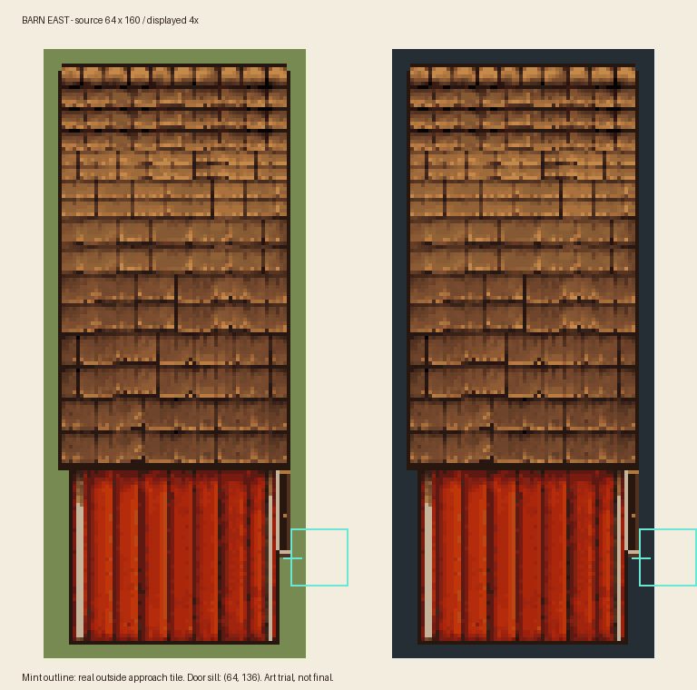

# Barn 四向试装素材

## 2026-10-15：0.1.9 门、通路和透明层修正

0.1.8 的独立空门框被否决；外部板条透过它看起来像梯子。现在用实木门板填充、连上取自项目原墙材的红墙 `barn-north-far-wall.png`（112×28），门框仍 16×28，槛锚点仍 `(8,26)`。新实际人门为 `(5,1)`，门槛在 North 图 `(88.5,59)`；首排成为横向通路，下一排才阻挡，预留范围不变。墙线、门槛和物理边界统一读取当前布局。

北向停止叠乘游戏整体 alpha，屋顶／墙面最低不透明度改为 .22／.38，底部原像素保持；原 113×107 图与互斥遮罩不变。新增后墙和门板采用用户此前允许的程序化像素编辑，只读项目自有图。离线示意不包含原版贴图或用户截图。



[坐标](north-reveal-layers.json) · [本版核对](verification-runtime-0.1.9.json)。原选的白边、大小和侧面配对保留。本图只检查层与坐标，不把它当作用户已经认可的门或实机碰撞效果。下方旧说明是历史。

## 2026-10-13：0.1.8 北门分层 Reveal 试装

纠正 0.1.7 的对应错误：East（入口朝右）看见无箱左墙，West（入口朝左）看见带木构右墙。原附件从正面右边旋转到 East 远侧／West 近侧；文件恢复已选稿，尺寸、白边和 North 原图不变。下方 0.1.7 的配对仅为被纠正的历史。

新增 `barn-north-roof.png`、`barn-north-wall.png`、`barn-north-base.png`，均为 113×107 的互斥图层，合成时逐可见像素还原原图。屋檐按现有曲线划分，底部六行保留原样。显露时屋顶 16%、墙体 30%，基座 100%；颜色／PNG alpha 不烘焙这些数值，由运行时平滑变化。

新增 16×28 的 `barn-north-entrance.png`，是单独重构的北门开放门框，白边和附着标记属于同一 sprite。锚点 `(8,26)` 放在真实北门格的外边缘中心；普通 Barn 在整张 North 图中为 `(88.5,43)`。没有把整张正面半透明盖上去。门外板条和带门缺口的地面轮廓由绘制层输出，不创建游戏物件。已补门框点击别名，仍受原门外一格和面向条件限制。



图中蓝色人形仅是遮挡检查标记。实际角色排序、显露范围、颜色及点击仍待实测，不能以此替代游戏截图。[生成脚本](../../../scripts/build-barn-north-reveal.py)只读取项目自有贴图；[分层坐标记录](north-reveal-layers.json)与[安装包核对](verification-runtime-0.1.8.json)保存了对应依据。用户先前未提交的概念稿不改动。

## 2026-10-13：0.1.7 两侧配图对应修正

实机反馈确认大小合适，用户要求 p2 左视不出现附属木箱。运行时现改为 **West／门朝左使用无木构整墙，East／门朝右使用带木构图**；两张 PNG 内容互换，未重新生成、调色或拉伸。尺寸、墙脚原点、North 和正面均保留。下面旧稿名及四视图的 LEFT／EAST 标签属于历史命名，不能再作为安装映射；此次按用户指定画面换图，不将此操作当作严格三维投影结论。

[0.1.7 安装包](../../../artifacts/BuildingRotation.Prototype-0.1.7.zip)内四个 DLL 沿用 0.1.6，具体 [核对记录](verification-runtime-0.1.7.json)。尺寸反馈通过不等于人物遮挡／Reveal 完成；青框仍是实际入口标记，没有距离触发逻辑。

## 2026-10-13：0.1.6 白边版已接入

用户看过四向对照后反馈“其实还行吧”，本次把选定 East 及新 West／North 原图直接放入运行时，未重新改图或压缩调色板。正面放下时使用游戏原绘制；预览使用游戏贴图和门图层。三向保持原生 4 倍，以占地中心和底边对齐。East／West 素材地面原点 `(12,-5)`，North 为 `(0.5,43)`，碰撞格及门区不变。

青色空心框标记真实门外格，北侧提示在屋顶上方绘制以便找门；尚未实现人物分层或 Reveal。新图高 107，而侧向地面深 112，顶端差 5 源像素；选择保留比例，实际农场里是否协调仍待看图。源码不再加载已被否决的 v2。

[安装包 0.1.6](../../../artifacts/BuildingRotation.Prototype-0.1.6.zip)已直接编译并检查九项内容，源图、安装图与包内图一致，见 [核对记录](verification-runtime-0.1.6.json)。标准 MSBuild 本轮遇到环境进程信息错误，具体替代编译与复现边界见 [安装说明](../../prototype-test.md)。下一步只看新绘制的位置、比例及遮挡，不重复未改动的核心测试。

## 2026-10-12：补齐白边版右侧与背面



选定的 East／建筑左视原稿 **88×107，文件不变**。新增 West／右视 `barn-west-white-trim-v1.png` 为 88×107；上方 79 行直接保留选稿屋顶、白边与红墙，下部是内置 imagegen 新画的近端附属木构。叉条盖板单独压为 7 像素深，整体木板墙下接共同地线，没有重复瓦片行或整体拉长屋顶。

新增 North／背面 `barn-north-white-trim-v1.png` 为 113×107；近侧整面红墙无门，附属木构在左，保留白檐边／立柱。正面沿用 v6 生成板作结构参照，缩为 114×107，不使用或发布解包的原版游戏 PNG。四面共享顶线、底线与 4 倍显示比例；原始生成结果保留为原生尺寸 `*-source.png`，未继续套用减色 v3。

已检查透明背景、107 像素可见高度、选稿文件散列与 West 屋顶一致性；新面尚待用户看图。背面瓦片亮度、附件尺度和严格投影仍可继续改。这套是外观研究稿，**运行时仍为 0.1.5 的旧图**；绘制原点、人物遮挡、入口视觉和 Reveal 尚未接入，本轮不构建或重新跑游戏逻辑测试。

复现：`python scripts/build-barn-white-trim-study.py`。生成方式为内置 imagegen，提示词见 [prompts-barn-white-trim-v1.json](prompts-barn-white-trim-v1.json)，源裁切／缩放与核对结果见 [inspection-barn-white-trim-v1.json](inspection-barn-white-trim-v1.json)。脚本只读取公开项目美术，明确保留已选 East，不写运行时目录。

## 当前基准：中间那张，保留亮白收边（2026-09-29）

用户表示更喜欢三栏对照中间的上一稿，随后明确“其实我就是喜欢那个白边”。后续以 `barn-east-closed-wall-height-study.png`（88×107）为基准，原样保留亮白檐边／立柱、瓦片层次和木墙质感。继续遵守整面侧墙、正侧面同高、宽度可不同的约定。不要再把白边当成缺陷，或自动套用减色／压高光处理。

材质 v3 保留为尝试记录，不作为后续默认稿；这次只更新选稿方向，不修改图片、运行时或安装包，也不代表整套四向素材已定稿。

## 历史尝试：材质修订 v3（未选为后续基准）

用户已确认上一张的方向：侧面整墙、与正面同高、宽度可不同。本轮保留该轮廓，修正油亮瓦片、光滑木墙及过白檐边，采用内置 imagegen 重绘后再整理为原生像素；[完整提示词与处理记录](prompts-barn-east-material-v3.json)。



`barn-east-material-v3.png` 为 88×107 RGBA，16 个不透明颜色，alpha 与已确认的高度稿逐字节相同。生成稿屋檐高了 3 像素，整理时将完整屋面、檐边、墙身对回原有分界，不重复瓦片排；再限制调色板、减弱屋面内部黑缝，并清掉零散亮点。檐边改为较柔和的粉米色。无门／窗／门框，墙面保持封闭。

原版正面／上一稿／新稿的同尺度对照已另行交付。用户已看过对照并偏好上一稿及其白边；v3 不作为后续基准。本轮未改运行层或出新包，也不重复输入／碰撞／存档测试。

复现：`python scripts/refine-barn-side-materials.py`；可选 `--original-barn /private/Barn.png --private-review /private/comparison.png` 生成含原版的私有对照。

## 已确认方向：完整侧墙与同高对照（2026-09-29）

用户也否决了 v2／0.1.5，并明确本轮要求：**侧面全部为墙，不必露门；拉出共同顶线和地线，宽度可以不同，总高最好一致。**

`barn-east-closed-wall-height-study.png` 从 v2 的完整源图整理：撤回额外窄门框和墙身局部收窄，保留连续墙面；按原版正面主体实际 alpha 边界 `(0,5,112,112)`，将整幅侧面等比缩小至 88×107，正面可见尺寸为 112×107。顶线与地线相距 107 源像素，离线对照统一放大四倍。宽度没有强制相同。

用户确认了墙面／高度方向；这不表示 v2 屋面纹理或整体美术已获接受。运行时仍为历史 0.1.5，未改碰撞／门触发，也没有新安装包。包含原版正面的对照单独交付，不放入公开仓库。

复现对照（原版参考由使用者自行提供）：

```sh
python scripts/review-barn-side-height.py --original-barn /private/Barn.png --review /private/Barn-side-height-alignment.png
```

## 历史：v2 / 安装包 0.1.5（用户已否决）

用户明确否决 v1 的长条屋顶；其美术不再采用。新版用内置 imagegen 完整重画并修订一次，再整理为原生素材。[完整提示词与处理来源](prompts-barn-east-v2.json)记录两次请求。



图中两栋同为四倍源像素显示，绿框是相同的 4×7 占地，青框是相同局部位置的门外格。新图同时有屋檐、侧墙柱和墙脚。完整屋面不再分条重复；生成图按二值 alpha 主体裁切、等比缩小，再单独把墙宽从 78 调整为 64 像素并定位窄门框，最后整理为 64 色。这里明确包含局部墙宽调整，不声称整条流程都保持等比。

| 项目 | v1（拒收） | v2（拒收） |
| --- | --- | --- |
| 原生画布 | 64×160 | 92×112 |
| 地面原点 | (0,48) | (14,0) |
| 地面范围 | 64×112 | 64×112，不变 |
| 人门源图阈值 | (64,136) | (78,88) |
| 扣除原点后的门槛 | (64,88) | (64,88)，不变 |

`barn-east-v2-source.png` 为完整生成稿缩小后的整理源，`scripts/build-barn-east-sprite.py` 从它生成游戏用 PNG 和本页对照；旧脚本保留为 `build-barn-east-sprite-v1.py`。v2 本身为 RGBA，alpha 仅 0/255。原版牛棚和用户人物的同尺度对照已另行交付；那些参考素材不放入公开仓库或 mod 安装包。

0.1.5 预览与日常绘制共用新画布原点，原碰撞、输入、门触发、存档不改。原生尺寸、门槛换算与墙脚边界已检查；离线对照不能代替游戏内人物遮挡检查，用户随后否决了这版外观；不能记为已通过美术验收。其他方向、分层 Reveal 和动物动画继续待办。

## 历史：v1（用户已否决）


2026-09-17：`barn-east-v1.png` 随实验包 0.1.4 接入拿起预览和日常绘制；尚未收到这一张素材的实机结果。用户已授权程序化裁切、重采样和像素整理。



素材来源为仓库 [Barn v6 四视图](../turnarounds/barn-four-views-v6.png) 的 LEFT 面板，对应游戏 East。按近似相同比例缩小屋瓦与墙材，再重复完整瓦片排和墙段，补像素轮廓与边缘门框。没有直接将整块侧视图拉伸，也未使用提取的原版游戏 PNG。此前带有假棋盘格背景的单张生成结果未采用。

| 对齐项 | 源像素坐标 |
| --- | --- |
| 画布 | 64×160，RGBA；透明度仅 0 或 255 |
| 地面原点 | (0,48) |
| 地面范围 | (0,48)，64×112，对应 4×7 格 |
| 人门阈值 | (64,136)；窄门框下沿贴此位置 |
| 门外接近格 | (64,128)，16×16；位于贴图右侧 |
| 游戏显示 | 源像素放大 4 倍；左上角为建筑原点向上 192 游戏像素 |

程序从 `rotation-template-anchors.json` 核对画布、地面原点与人门阈值，预览青框也读取该文件。这个锚点方案用于试装，不代表概念板已经满足原版投影。屋面偏长、重复纹理和门口偏窄是本稿需要在农场画面里判断的地方。

运行层用 SMAPI 加载贴图，朝东预览显示图像、红绿占地边框及门外青框；放下后显示图像与门外青框。日常建筑沿用底边／SortTileOffset 排序，本稿仍为单层，人物遮挡待实测。其他已接管朝向保留原占位图；没有新增 Reveal、阴影层、动物门动画或皮肤适配。碰撞、门触发、输入和存档逻辑未改。

复现需要 Python 和 Pillow：

```sh
python scripts/build-barn-east-sprite.py
```

输出游戏素材到 `src/BuildingRotation.Smapi/assets/barn-east-v1.png`，本页预览只供检查，不进安装包。两张图与源代码一起保存在仓库；原游戏文件及失败生成图不随包发布。
